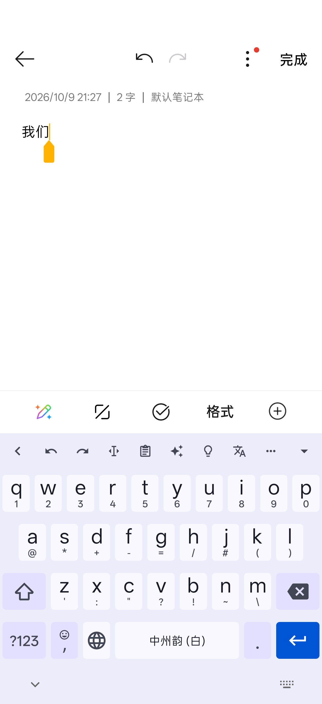
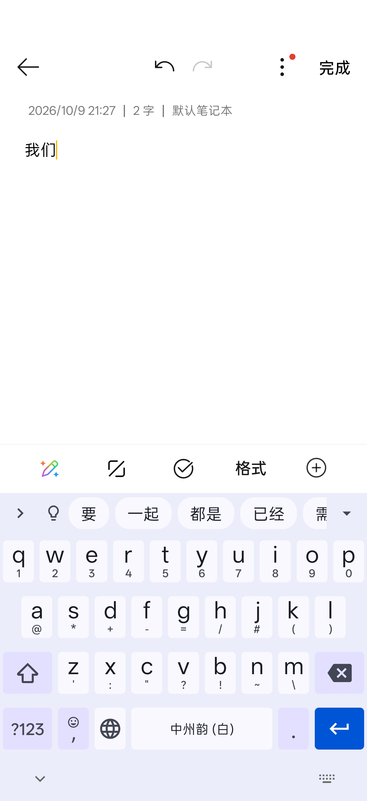
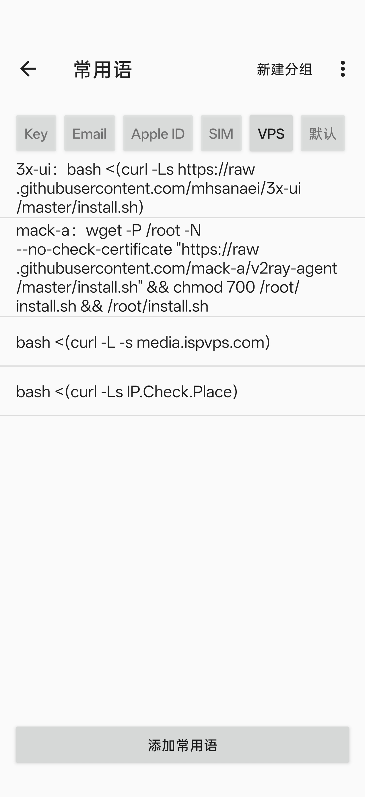
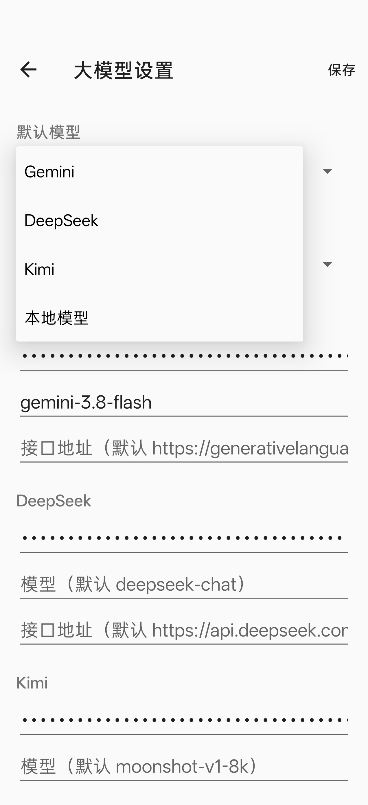
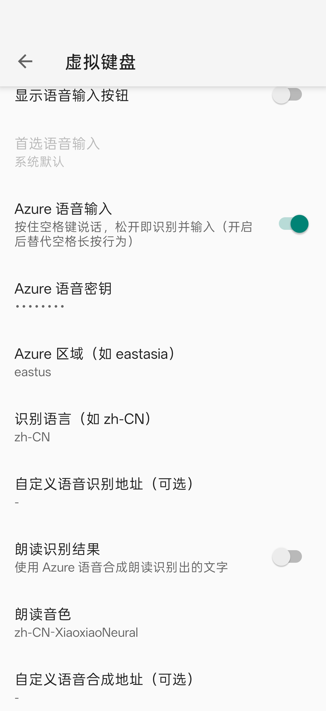
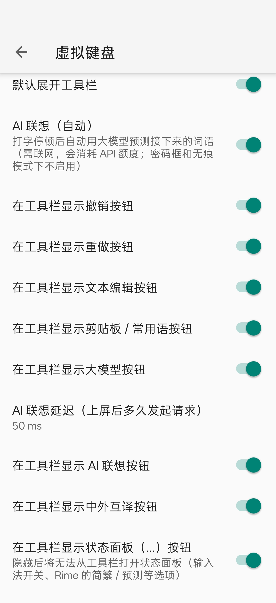

# 修改版说明（fcitx5-android-mod）

本仓库是 [fcitx5-android/fcitx5-android](https://github.com/fcitx5-android/fcitx5-android)（小企鹅输入法 Android 版）的修改版，在原版基础上增加了常用语、离线 / 在线语音输入、大模型助手、AI 联想、中外互译、短信验证码、Bitwarden 集成、剪贴板同步等功能。

- 基于原版：0.1.3（提交 `e6199a28`）。之后每天自动合并原版更新。
- 与原版的完整代码差异：[对比页面](https://github.com/fcitx5-android/fcitx5-android/compare/master...clusflah:fcitx5-android-mod:master)
- 下载：[Releases](https://github.com/clusflah/fcitx5-android-mod/releases)
- 原版的说明（编译方法、插件、翻译等）：[README.md](../README.md)

---

## 安装须知

| 项目 | 原版 | 修改版 |
|---|---|---|
| 主程序包名 | `org.fcitx.fcitx5.android` | `org.fcitx.fcitx5.android.mod` |
| 插件包名 | `org.fcitx.fcitx5.android.plugin.xxx` | `org.fcitx.fcitx5.android.plugin.xxx.mod` |
| 支持架构 | 多种 | 仅 arm64-v8a（绝大多数手机） |

- 修改版和原版**可以同时安装**，互不影响。
- 修改版**不能使用原版的插件**，原版也不能使用修改版的插件。插件请从本仓库同一个 Release 下载，它们和主程序用的是同一个签名。
- 原版的备份可以导入修改版，见下文“备份与恢复”。

### 全家桶（all-in-one 分支）

把**所有插件都编进主程序**的版本，装一个 APK 就能用，不用再一个个装插件。代码在 [`all-in-one`](https://github.com/clusflah/fcitx5-android-mod/tree/all-in-one) 分支，功能和修改版主程序完全相同。

| 项目 | 修改版 | 全家桶 |
|---|---|---|
| 包名 | `org.fcitx.fcitx5.android.mod` | `org.fcitx.fcitx5.android.mod.all` |
| 桌面名称 | 小企鹅输入法 | 小企鹅输入法 全家桶 |
| 版本号 | `0.1.3-mod.N` | `0.1.3-mod.N-all` |
| 插件 | 单独安装 | 全部内置：Rime、日语 Anthy、注音、韩语、粤拼、僧伽罗语、泰语、越南语，剪贴板过滤、剪贴板同步 |
| Rime 方案 | 自己放入 | 内置**白霜拼音**（[gaboolic/rime-frost](https://github.com/gaboolic/rime-frost)），含全拼、双拼、九键 |

- 和修改版、原版**都能同时安装**，互不影响；但设置、词库不互通（不同的包名）。可以用“备份与恢复”导出、再导入。
- 全家桶**不使用**另外安装的插件。
- 内置插件在 设置 → 插件 里列出，标着“内置”；点“剪贴板同步”打开它的设置。下拉通知栏里的“剪贴板同步”磁贴照常可用。
- 全家桶**允许明文 http**，这样内置的剪贴板同步能连局域网的 `http://192.168.x.x` 服务器。带密钥的请求仍然受限：大模型、Azure 语音的地址如果是 http，只能是本机（127.0.0.1 / localhost），否则会提示改用 https，避免密钥被明文发送。
- 剪贴板同步插件改编自 GPL-3.0 项目，白霜拼音也是 GPL-3.0，所以全家桶 APK 整体按 GPL-3.0 分发（源码都在本仓库和白霜仓库）。
- **白霜拼音已内置**，装好后在 Rime 里直接就是白霜（全拼、自然码 / 微软 / 搜狗 / 小鹤双拼、九键、五笔等，见白霜的 `default.yaml`），九宫格也能直接打中文。
  - 白霜放在 Rime 的共享数据里。你自己放进 Rime 文件夹（`Android/data/org.fcitx.fcitx5.android.mod.all/files/data/rime/`）的同名文件和 `*.custom.yaml` 优先，不会被覆盖；万象语法模型的配置照上文第 14 节加。
  - **第一次用 Rime 时要部署**：白霜词库较大，第一次切到 Rime（或点“重新部署”）要等几十秒到一两分钟，期间打不出字，之后就正常了。
  - 编译时下载固定版本的白霜，校验文件后打包（不含 `others/` 和默认没启用的腾讯词库）。白霜更新后，改 `app/build.gradle.kts` 里的版本号和校验值即可跟进。
- 全家桶的 APK 比较大（Rime 等插件和白霜的数据都在里面）。第一次打开时要把这些数据解压到手机上，会比修改版慢几秒。

---

## 截图一览

<table>
  <tr>
    <td align="center"><br>键盘工具栏</td>
    <td align="center"><br>AI 联想</td>
    <td align="center"><br>常用语管理</td>
  </tr>
  <tr>
    <td align="center"><br>大模型设置</td>
    <td align="center"><br>Azure 语音设置</td>
    <td align="center"><br>工具栏按钮设置</td>
  </tr>
</table>

---

## 新增功能

### 1. 常用语


把经常要输入的内容（学号、地址、邮箱、固定回复等）存起来，在键盘上一点就能输入。

- **分组管理**：可以新建分组；长按分组标签可以重命名、排序、删除。
- **每条常用语**由“说明”（如“学号”）和“内容”（如“20100710”）组成。说明只用于显示，点击时输入的是内容。
- **入口**
  - 键盘工具栏的剪贴板按钮 → 剪贴板窗口右上角的“常用语”按钮
  - 设置主页 → 常用语（管理、编辑、排序）
- 数据保存在应用私有目录的 `common_phrases.json` 中，会一起写入备份。
- 截图中，上方是分组标签（当前选中的是“VPS”分组），下方是这个分组里的常用语。点“添加常用语”可以新增。

<br clear="right">

### 2. 语音输入（按住空格说话）：离线 SenseVoice / Azure


**按住空格键说话，松开即识别并输入**。识别引擎和相关设置都在 **设置 → 语音模型** 页面：最上面选**语音识别引擎**，下面是 SenseVoice 模型的下载 / 导入 / 删除，再下面是 Azure 的密钥、区域、朗读等设置（以前在“虚拟键盘”页，已经填好的值会保留）。

- **大模型纠错**（设置 → 语音模型 →“语音输入后用大模型纠错”，默认关闭）：识别出文字后，先交给默认大模型的**快速模型**（就是 AI 联想用的那个）修正同音字、错别字和标点，再输入。状态栏会短暂显示“纠错中…”。
  - 打开后，识别出的文字会发到大模型服务（离线识别也一样）；**密码框和无痕模式下不纠错**。
  - 大模型出错、超过 8 秒没回复，或者回复明显不是纠错（比如长度差太多，像是在回答问题），都直接输入原来的识别结果。
  - 按住空格说话和工具栏话筒两种方式都会纠错。
- **SenseVoice（离线，免费）**：阿里开源的 [SenseVoice](https://github.com/FunAudioLLM/SenseVoice) 语音识别模型，通过 [sherpa-onnx](https://github.com/k2-fsa/sherpa-onnx)（Apache-2.0）在手机上运行。
  - 支持**普通话、粤语、英语、日语、韩语**，自动加标点，数字写成阿拉伯数字。
  - **录音只在手机上识别，不联网、不收费。**
  - 模型约 227 MB，不打包在 APK 里：在 **设置 → 语音模型** 中下载（用系统下载器，离开页面也会继续），或者在电脑上下载后用“从文件导入”。下载源是 Hugging Face 上 k2-fsa 导出的 `sherpa-onnx-sense-voice-zh-en-ja-ko-yue-int8-2025-09-09`；国内网络可能需要代理，也可以试 hf-mirror 镜像。
  - 按下空格时就开始在后台加载模型，松开后马上识别。识别时占用约 300 MB 内存，闲置 5 分钟后自动释放。
  - 加入这个功能后，APK 大约增加 10 MB（sherpa-onnx 和 onnxruntime 的 arm64 原生库）。
- **Azure（云端，需要密钥）**：使用微软 Azure 语音服务。

通用说明：
- **在线服务不可用时改用离线模型**（设置 → 语音模型，默认开启）：引擎选 Azure 时，如果识别失败（断网、超时、密钥有误等），并且离线模型已经下载好，就**用同一段录音交给 SenseVoice 重新识别**，不用再说一遍，工具栏会提示“Azure 不可用，已用离线识别”。只会从在线退到离线，不会反过来。
- 开启：设置 → 虚拟键盘 → **按住空格语音输入**。开启后会替代原来的空格长按功能。开启后空格键上会显示 🎤 图标（九宫格居中，全键盘在输入法名称左边），密码框里不显示。
- 选了离线引擎但还没下载模型时，长按空格会提示，并打开“语音模型”页面。
- Azure 需要填写：**Azure 语音密钥**和**区域**（如 `eastasia`）。识别语言默认是 `zh-CN`；如果用自建或代理服务，可以填自定义的识别地址。
- 录音时工具栏会显示音量和状态，最长录 60 秒，超时会自动结束。
- **朗读识别结果**（可选）：用 Azure 语音合成把识别出来的文字读出来，可以选择音色（默认 `zh-CN-XiaoxiaoNeural`）。
- 第一次使用会请求麦克风权限；授权后再按住空格即可。
- **密码输入框里不会录音**：在密码框中长按空格，执行的是原来的空格长按功能（设置 → 虚拟键盘 → 空格长按行为）。
- 用 Azure 时需要你自己申请 Azure 语音服务密钥，产生的费用由你的 Azure 账号承担。朗读识别结果目前只支持 Azure。
- **工具栏 🎤 按钮**（设置 → 虚拟键盘 → **工具栏按钮** → **语音输入**）：
  - 关闭（默认）：不显示。
  - 打开：工具栏里多一个 🎤（和其他工具栏按钮一样，展开工具栏才显示；钉住“常驻右侧”后放在 ▾ 左边，工具栏收起时也显示），**用修改版自己的语音识别**（跟随上面的“语音识别引擎”，比如离线 SenseVoice），不需要另外安装语音输入法。**点一下开始录音，再点一下结束并识别**，工具栏会显示“正在聆听… 再点 🎤 结束”；最长 60 秒，超时会自动结束。
  - 密码框里不显示 🎤。
  - 原版的这个按钮是切换到系统里另一个“语音输入法”（比如 Gboard），需要手机上装着并启用这样的输入法才会出现；修改版改成了直接使用自己的识别，所以原版的“首选语音输入”这一项已经从设置里去掉了。
  - 这个按钮和“按住空格语音输入”互不依赖，可以只开其中一个，也可以两个都开。
  - 屏幕最底下系统导航栏里的 ⌄（收起键盘）和 ⌨（切换输入法）是系统画的，输入法改不了。

<br clear="right">

### 3. 大模型助手
从键盘工具栏打开一个对话框，用大模型处理文字，处理完可以直接输入到当前应用。


- **支持的服务**：Gemini、DeepSeek、Kimi，以及任意兼容 OpenAI 接口的**本地模型**（默认地址 `http://127.0.0.1:8080/v1`，例如在手机上运行的 Pocket LLM）。
- 每个服务可以分别设置 API Key、模型名称和接口地址。设置入口：设置主页 → 大模型助手，或者对话框里的“⚙ 设置”。
- 模型名称留空时的默认值：**大模型助手默认用各家最好的模型，AI 联想默认用最快的模型**。

  | 服务 | 助手默认（最好） | 联想默认（最快） |
  |---|---|---|
  | Gemini | `gemini-3.1-pro-preview` | `gemini-3.5-flash-lite` |
  | DeepSeek | `deepseek-v4-pro` | `deepseek-flash` |
  | Kimi | `kimi-k3` | `kimi-k2.6` |
  | 本地模型 | `qwen3_litert`（填 `/v1/models` 返回的模型 id） | 与助手的模型相同 |

  > 最好的模型更慢、也更贵。`gemini-3.1-pro-preview` 是预览版，Google 可能提前两周通知后停用；到时候在设置里填一个新模型名就行，比如 `gemini-3.8-flash`。

- **获取模型列表**：每个模型名称输入框下面都有“获取模型列表”按钮，会用当前填写的 API Key 和接口地址向服务商查询可用的模型，点一下就填进去，可以搜索。设置页里的助手模型、AI 联想模型、图片模型，以及对话框里的“⚙ 设置”都能用。Gemini 只列出能对话的模型（选图片模型时只列出图片模型）；其他服务列出 `/models` 返回的全部模型。
- 如果填的是**已经停用的模型名**（`deepseek-chat`、`deepseek-reasoner`、`moonshot-v1-*`、`kimi-k2-*`、`kimi-k2.5`、`kimi-latest` 等），会自动改用上面的默认模型，设置页里这一栏也会显示为空。
- **内置提示词**：润色、翻译成英文、翻译成中文、帮我回复、总结、直接提问。提示词可以自定义、增删。
- **使用流程**：打开时会自动填入剪贴板内容 → 选择提示词 → 发送 → 模型的回复可以修改 → 点“输入”，回复会打进刚才的应用（同时复制到剪贴板作为备份）。也可以重新生成或复制。
- **长按工具栏的大模型按钮**：弹出提示词菜单（上次用的打 ✓），选一个后，直接用默认模型处理输入框里的文字（有选中的文字就只处理选中部分），回复**原地替换**原文，不用打开对话框。和翻译按钮的长按一样：等待时状态栏显示进度；如果这期间输入框内容变了，就不替换。回复按对话框里选的显示格式转换（默认纯文本）。密码框和无痕模式下不可用。
- **回复的显示格式**：模型通常用 Markdown 回答（`**加粗**`、`# 标题`、`- 列表`、表格等），直接打进聊天软件不好读。回复框右上角可以切换三种格式，选择会被记住：
  - **纯文本**（默认）：去掉 Markdown 符号，列表变成“• ”，表格变成“名称 | 数量”一行一行，链接写成“文字 (网址)”。适合微信、短信等只支持纯文本的地方。
  - **富文本**：所见即所得，标题、加粗、斜体、删除线、代码按样式显示。点“输入”时尽量带格式输入（支持富文本的编辑框会保留样式，其他应用会自动变成纯文本）；“复制”会同时放入 HTML，粘贴到笔记、邮件等支持格式的应用时保留样式。
  - **Markdown**：模型的原始回复，适合粘贴到支持 Markdown 的笔记或代码里。
  - 在 Markdown 格式下修改的内容，切换到其他格式时会保留；在纯文本 / 富文本下的修改，切换格式后会被原始回复覆盖。
- **画图（生成图片）**：在对话框输入图片描述，点“画图”。如果选中的提示词里有 `{{input}}`，会套用这个提示词。
  - 生成的图片可以：点“输入”插入到刚才的应用（需要输入框支持插入图片，比如 Telegram、WhatsApp、Google 信息；不支持的应用会提示，图片已在剪贴板里，可以长按粘贴）、“复制”、“保存到相册”（`Pictures/Fcitx5`，需要 Android 10 及以上）、“分享”、“重新生成”。
  - 在 设置 → 大模型助手 → **图片生成** 里选择服务和图片模型，使用该服务已填写的 API Key 和接口地址。
  - **Gemini**：默认 `gemini-nano-banana-2.1`。Google 的图片模型更新很快，建议点“获取模型列表”选择当前可用的（如 `gemini-3.1-flash-lite-image`、`gemini-3-pro-image`）。图片按张收费，免费额度很少。
  - **其他服务**：调用 OpenAI 兼容的 `/images/generations` 接口，必须填写模型名。DeepSeek 和 Kimi 官方没有生成图片的接口；本地模型或把接口地址改成支持生图的中转服务时可以用。
- API Key 只保存在手机本地，代码中没有任何内置密钥。
- 截图是“大模型设置”页面：最上面选默认模型，下面每个服务各有 API Key、模型名称和接口地址三栏。模型名称留空就用默认模型；也可以填其他模型名，比如截图里 Gemini 填的就是自定义的模型名。改完点右上角“保存”。

<br clear="right">

### 4. 中外互译
工具栏上的 **文A** 按钮：

- **点按**：在键盘上方打开**翻译卡片**（“中外互译 ∨ … 收起”）。打开后键盘打的字进到卡片的输入框里，不会进 App；点“翻译”或回车键，把译文发到 App 的输入框，卡片清空后可以接着翻下一句。点“中外互译 ∨”选目标语言，点“收起”关闭。关闭了“圆形按钮与卡片式面板”时，点按还是像以前一样打开翻译窗口（有选中文字时自动翻译，点“输入”替换到原来的位置）。
- **长按：就地翻译**。把输入框里的全部文字（有选中文字时只翻译选中的部分）**直接替换成译文**，不弹窗口。翻译过程中工具栏会显示“翻译中… → 日语（Index-Translate）”。
  - 典型用法：给外国朋友发消息，先用中文打完，长按“文A”，一秒左右就变成外文，直接发送。
  - 等待翻译的过程中，如果输入框内容变了（比如又打了字、切换了输入框），就不替换，避免覆盖新内容。
  - 翻错了可以用工具栏的“撤销”恢复（前提是 App 支持撤销）。
  - 密码框里不翻译。
- **翻译方向**：**中文 → 在设置中选择的目标语言**（默认英语，可选日语、韩语、法语、德语、西班牙语、俄语等）；**外文 → 简体中文**。方向自动判断，平时操作不用选。
- **翻译引擎**（大模型设置 → 中外互译 → 翻译使用）：
  - **Index-Translate（B站免费）**，默认：B 站开源的翻译专用模型（[bilibili/Index-Translate](https://github.com/bilibili/Index-Translate)，35B 版本）。免费、**不需要 API Key**、不需要“思考”，一般 1 秒左右出结果，网络用语也翻得地道。
  - **离线翻译（Offline Translator App）**：调用另外安装的开源 App [Offline Translator](https://github.com/DavidVentura/offline-translator)（GPL-3.0），它在手机上运行 Mozilla Firefox 翻译用的 Bergamot 模型，**文字不会离开手机**。每个语言包几十 MB，要先在那个 App 里下载（中文、英语、日语等）。翻译质量不如 Index-Translate，但完全离线。选它时，失败了**不会**自动改用云端服务，避免文字被发出去。修改版只是通过它公开的接口调用，没有复制它的代码。
  - 也可以选 Gemini、DeepSeek、Kimi 或本地模型。用它们翻译时会关闭“思考”，以提高速度。
- **隐私与可用性**：
  - 只有点翻译时才会发送文字，打字过程中不会发送。用 Index-Translate 时，文字会发到 B 站的服务器。官方没有公布这个免费接口的隐私政策、调用限制和服务期限。
  - **在线翻译失败时的回退**（“在线服务不可用时改用离线模型”，默认开启；语音模型页面和大模型设置的中外互译里都能改，是同一个开关）：
    - Index-Translate 不可用（限流、改成要 Key、停止服务、断网等）时：装了 Offline Translator 就**改用离线翻译**；没装就像以前一样，改用你在大模型设置里选的默认模型。
    - Gemini / DeepSeek / Kimi / 本地模型 失败时：装了 Offline Translator 就改用离线翻译，否则提示失败。
    - 发生回退时会提示“在线翻译不可用，已改用离线翻译”（长按“文A”时弹出提示，翻译窗口里显示在方向说明后面），离线翻译的质量差一些，这样能知道是哪个引擎翻的。
    - 只会从在线退到离线。选了“离线翻译”时，出错也不会改用在线服务。
- **离线翻译（可选，不需要改代码）**：Index-Translate 有 2B 的 GGUF 模型文件（`IndexTeam/Index-Translate-2B-GGUF`，也可以从 ModelScope 下载），可以在手机上用 Termux 运行 llama.cpp 的 `llama-server`（默认端口 8080），再把“翻译使用”选成**本地模型**，模型名填它返回的 id，就能离线翻译。2B 的质量不如云端的 35B；Termux 需要加入电池优化白名单，以免被系统杀掉。

### 4b. 默认外观：Jade 主题和卡片式面板
仿照常见国产手机输入法的样子：

- **Jade 浅色 / 深色主题**，默认跟随系统切换：浅灰色键盘底，白色字母键，灰色功能键（回车也是灰色），绿色强调色。独立的圆角按键（“按键边框”）默认打开，按键圆角 8dp，剪贴板条目圆角 14dp。想换回原版的主题，在 设置 → 主题 里选。
- **圆形按钮与卡片式面板**（设置 → 主题，默认开启）：
  - 工具栏和各个面板的按钮放在白色圆形底上；面板左上角用 ∧ 关闭，代替 ←。
  - “更多”（状态面板）里的项目是 4 列浅色圆角卡片：图标在上，灰色文字在下。Rime 的开关（如“翻译关 → 翻译开”“开启预测 → 关闭预测”）只显示当前状态的简短名字（“翻译”“预测”），开着的卡片是绿色、关着的是灰色；“简体 → 繁体”这类二选一的只显示当前那一边（“简体”）。
  - **键盘选择**面板（工具栏 ▦）：一张圆角卡片，当前使用的那项是白底绿字。
  - 剪贴板和常用语的工具栏中间是“**剪贴板 | 常用语**”分段切换，左边 ∧，右边是清空剪贴板 / 管理常用语。
  - 语音面板：淡绿色渐变背景、跟随音量跳动的绿色声波，底部白色弧形区域点一下结束录音。
  - 中外互译的翻译卡片，见上一节。
  - 长按大模型按钮弹出的提示词菜单、翻译卡片的目标语言菜单，也是键盘配色的圆角卡片，当前项绿色带 ✓。
  - **大模型助手 / 中外互译弹框**也换成键盘的配色：圆角卡片，白色圆角按钮，绿色的“发送 / 翻译 / 输入”，白色圆角输入框，选中的提示词是白底绿字。弹框做得很矮、位置偏下（靠近键盘）：模型和 ⚙ 缩到右上角，提示词只占一行（左右滑动看更多），输入框默认一行、随内容变高。从它打开的“大模型设置”、新建 / 编辑 Prompt、Prompt 菜单、选择模型和出错提示，也是同样的样式。
  - 关闭这个开关，就恢复成原版的样式。

### 5. AI 联想
根据光标前已经输入的文字，让大模型预测接下来可能要输入的 5 个词语或短语，点一下就能输入。


截图中输入“我们”之后，工具栏上自动出现了 AI 联想的结果：要、一起、都是、已经……左边的灯泡图标表示这是 AI 联想，点任意一个词就会直接输入。

- **自动模式**：打字停顿后，联想结果会自动出现在工具栏上。点工具栏的 AI 联想按钮可以开启或关闭自动模式，停顿多久后触发也可以在设置里调整（默认 50 毫秒）。
- **手动模式**：长按 AI 联想按钮，会打开联想面板，可以“换一批”。
- AI 联想可以**单独选择服务和模型**：在“大模型设置 → AI 联想使用的模型”里，先选服务，再在下面的输入框填联想专用的模型名。比如大模型助手用 `gemini-3.8-flash`，联想用更快、更便宜的 `gemini-3.5-flash-lite`。联想模型名是按服务分别保存的；留空则使用该服务最快的模型（见上表）。联想面板和“新手机检查”都会显示当前实际用的模型。
- 使用本地模型时会自动缩短上下文，以加快速度。
- **连续联想次数限制**（设置 → 虚拟键盘 → AI 联想连续次数，默认 **2**）：点选一个联想词后会接着联想下一个；连续点选超过这个次数后就不再自动联想，等你自己打字、删字或移动光标后才会恢复。可以节省 API 额度，也减少干扰。设为 0 表示不限制。
- 新一代模型默认会先“思考”再回答，联想时会变慢，甚至因为输出长度被思考用完而返回空结果。所以 AI 联想会自动关闭或降低思考：
  - DeepSeek、`kimi-k2.6`：关闭思考（`thinking: disabled`）
  - Gemini 3 Flash：思考等级设为 `low`（Gemini 3 关不掉思考；Flash-Lite 默认就是最低的 `minimal`）
  - `kimi-k3`：关不掉思考，推理强度设为 `low`
  - 大模型助手（润色、翻译等）仍然用各家默认的思考设置，回答质量更好，但会慢一些。
- 联想会把光标前的文字发送给你选择的模型服务，所以：
  - **密码输入框和无痕模式下不会启用**；
  - 使用云端模型会消耗 API 额度。

<br clear="right">

### 6. 工具栏按钮自定义
设置 → 虚拟键盘 → **工具栏按钮** 是统一入口：在一个页面里打开或关闭每一个工具栏按钮（撤销、重做、文本编辑、剪贴板/常用语、大模型助手、中外互译、AI 联想、九宫格切换、Bitwarden、状态面板 …、语音输入），用 ↑ ↓ **调整它们在工具栏上的顺序**；点图钉可以把按钮**常驻右侧**：放在收起键盘按钮（▾）左边，工具栏收起时也显示，没钉住的按钮只在展开工具栏后出现。按钮太多一行放不下时，按钮保持原来大小，工具栏可以左右滑动。

<table>
  <tr>
    <td align="center"><br>展开后的工具栏</td>
    <td align="center"><br>设置 → 虚拟键盘</td>
  </tr>
</table>

默认顺序从左到右依次是：

| 图标 | 功能 |
|---|---|
| ‹ | 收起工具栏 |
| ↶ ↷ | 撤销 / 重做 |
| 光标 | 文本编辑（移动光标、选择、复制粘贴） |
| 剪贴板 | 剪贴板（右上角可以切换到常用语） |
| ✦ 星星 | 大模型助手 |
| 💡 灯泡 | AI 联想：点击开关自动联想，长按打开联想面板 |
| 文A | 中外互译 |
| ▦ | 键盘选择：九宫格拼音、全键盘拼音、其他已启用的输入法、键盘管理；长按直接切换九宫格 / 全键盘 |
| 🔑 钥匙 | 打开 Bitwarden（只有安装了才会显示） |
| … | 状态面板 |
| 🎤 | 语音输入（默认关闭） |

> 隐藏状态面板按钮后，就无法从工具栏打开状态面板（输入法开关、Rime 的简繁/预测等选项）了。

### 7. 新手机检查
换新手机并恢复备份之后，会逐项检查哪些内容备份带不过来、还需要在新手机上手动处理：

- 输入法是否已启用、是否设为默认输入法
- Rime 插件是否已安装（备份里有 Rime 用户文件时会提醒）
- 剪贴板同步插件的服务器配置（不在备份里，需要重新填写）
- 语音输入的密钥和麦克风权限
- 大模型的 API Key 和本地模型配置

每一项都有对应的按钮，可以直接跳到要处理的地方。导入备份后，下次打开应用时会自动显示这个页面；也可以从 设置主页 → 新手机检查 手动打开。

### 8. 备份与恢复增强
- 备份中**额外包含常用语**。
- 可以导入**原版和其他变体**（`.debug`、`.mod`）的备份；导入时设置项会自动转换到当前版本。

### 9. 新插件：剪贴板同步（clipboard-sync）
和 [SyncClipboard](https://github.com/Jeric-X/SyncClipboard) 服务器（或 WebDAV）同步剪贴板，可以在手机和电脑之间互传文字和文件。改编自 [qh7574/Fcitx5-SyncClipboard](https://github.com/qh7574/Fcitx5-SyncClipboard)，改成了本仓库的插件结构，这样可以用同一个签名编译，并且能找到修改版的主程序。

- **多服务器、自动切换**：可以添加多个服务器（比如同一个服务的局域网地址和公网地址），每个分别填写名称、地址（如 `http://192.168.1.100:5000/clipboard`，会自动拼接 `SyncClipboard.json`）、用户名和密码。
  - 按列表顺序决定优先级：点服务器 →“更多”→ 上移/下移/删除/测试连接。
  - 一直使用当前的服务器；**连不上时，自动按顺序切换到下一个能连上的服务器**。
  - 每 5 分钟会重新尝试排在前面的服务器，比如回到家后，会自动切回局域网地址。
  - 设置页里，正在使用的服务器会标出“✅ 正在使用”；“测试连接”会依次测试所有服务器并列出结果。
  - 旧版本只能填一个服务器，升级后原来的配置会自动变成列表里的第一个服务器。
  - 多个地址最好指向**同一份剪贴板数据**。插件会分别记住每台服务器上次的内容：切换到另一台服务器时，那台服务器上原有的（往往是很久以前的）内容不会被当成新内容写进剪贴板；只有切换后它上面又出现的新内容才会同步过来。
- **只在键盘弹出时同步**：键盘显示期间按同步间隔从服务器拉取，键盘收起就停止。因为 Android 13 起，任何 App 写入剪贴板都会在左下角弹出系统的剪贴板预览（带“发送至设备”），在后台拉取会让这个预览随时冒出来。手机上复制的内容仍然会立即上传。
- 同步间隔、下载目录在“其他设置”里；收到的文件会保存到你选择的下载目录。
- 插件记住上次从服务器取到的内容（只存哈希），重启或重连后不会把服务器上已经同步过的旧内容再写回剪贴板，避免键盘莫名弹出一条旧的剪贴板建议。
- 提供**快捷设置磁贴**（下拉通知栏里的“剪贴板同步”），可以一键开关同步；Android 10 及以上，磁贴下方会显示正在使用的服务器。
- 插件包名：`org.fcitx.fcitx5.android.plugin.clipboard_sync.mod`

### 10. 短信验证码
收到验证码短信后，工具栏上会显示 **「验证码 · 招商银行　[123456]　✕」**，点一下验证码就会输入。

- **开启**：设置 → 虚拟键盘 → **短信验证码**。开启后第一次弹出键盘时，工具栏会提示“去允许”，点一下授予读取短信的权限。“新手机检查”里也有这一项。
- **智能自动填入**（可选，默认关闭）：设置 → 虚拟键盘 → **验证码智能自动填入**。当前输入框看起来是验证码框（输入框的提示文字或控件名里有“验证码”“code”“otp”等），并且框是空的，就会自动填入 **1 分钟内**收到的验证码。每个验证码只自动填一次。
  - 一个常见场景：先在 App 里点“获取验证码”，光标停在验证码框里等着，短信一到就会自动填好。
- 只显示 **5 分钟内**收到的验证码；用过或点 ✕ 关闭后就不再显示。
- 识别规则：短信里要有“验证码 / 校验码 / 动态密码 / code / OTP”等关键词，取离关键词最近的 4–8 位数字或字母数字组合。金额、卡号尾号、“5 分钟”这类数字会被排除。没有关键词的短信（比如订单通知）不会识别。
- **隐私**：
  - 只读取最近 5 分钟内的短信，验证码只存在内存里，不写入文件、不打日志、**不联网、不发给任何服务**。
  - 验证码框里不会启用 AI 联想；输入验证码之后，在这个输入框里也不会再触发 AI 联想，避免验证码被当作上下文发给大模型。
- **限制**：
  - 一加 / OPPO / realme（ColorOS、OxygenOS）、小米（HyperOS）等国产系统，可能有“验证码短信保护”“通知类短信”之类的设置，会拦截第三方 App 读取验证码短信。读不到时，到系统设置的应用权限、短信或隐私设置里，给本输入法放行。
  - 按 Android 的规定，带 SMS Retriever 哈希或 WebOTP 格式的验证码短信，第三方 App 要等 3 小时才能读到（国内短信很少用这两种格式）。
  - 只读短信。App 推送通知里的验证码不支持：Android 15 起，系统会对第三方 App 隐藏含验证码的通知内容。
- **复制的验证码**（设置 → 虚拟键盘 → **复制的验证码**，默认开启，不需要任何权限）：复制了一段只有 6–8 位数字的内容时（比如 Bitwarden 自动填充后复制的两步验证码），也会显示在这一栏，来源写“密码管理器”或“剪贴板”。只显示 90 秒（两步验证码 30 秒就会换一个），智能自动填入同样适用。

### 11. Bitwarden 集成
通过 Android 系统的**自动填充框架**集成。输入法只负责显示 Bitwarden 提供的账号建议按钮，**读不到密码库、用户名或密码**。点建议后，由 Bitwarden 直接把账号和密码填进 App。

- **设置步骤**（只需一次）：
  1. Bitwarden → 设置 → 自动填充 → 打开 **自动填充服务**（会跳到系统设置，选择 Bitwarden）；
  2. 在同一页打开 **使用内联自动填充**（Inline autofill）；
  3. 本输入法：设置 → 虚拟键盘 → **内联建议** 保持开启（默认开启）。
  - “新手机检查”会检查前两项，并提供打开 Bitwarden 的按钮。内联建议需要 Android 11 及以上。
- **登录页的体验**：
  - 点进账号或密码框，工具栏上出现 Bitwarden 的账号建议，点一下就填好账号和密码；
  - 修改版的 AI 联想和剪贴板建议，优先级都**低于** Bitwarden 的建议，不会把它挤掉；
  - 出现自动填充建议时，以及在邮箱、网址、密码框里，**都不会触发 AI 联想**，账号不会被发给大模型。
- **长按钥匙按钮生成用户名 / 密码**：长按工具栏的 🔑（Bitwarden）按钮，上方左右各出现一个圆：左边“用户名”、右边“密码”。手指不松开往左或往右滑（不用正好滑到圆上），对应的圆变绿，松手即生成；没滑动就松手是取消。点按还是打开 Bitwarden。
  - 由输入法自己生成（Bitwarden 没有给其他 App 用的生成接口）：密码 16 位，含大小写字母、数字和符号，去掉了 l/1/O/0 这类易混字符，用系统安全随机数；用户名形如 `brisk.otter42`。
  - 生成后输入到当前输入框，同时**复制到剪贴板**，以免 App 没记下时找不回。密码只在密码框里输入，在其他输入框只复制到剪贴板。
  - 密码以“敏感内容”复制：系统剪贴板预览会遮住它，**剪贴板同步、剪贴板过滤等插件不会收到它**（不会被上传到同步服务器）。
  - 想存进 Bitwarden：Bitwarden 是自动填充服务时，提交注册表单后通常会提示保存。
- **两步验证码**：如果在 Bitwarden 里开启了“自动复制 TOTP”，填好密码后两步验证码会被复制到剪贴板，接着就会显示在工具栏的验证码栏里（见上一节“复制的验证码”）；开了智能自动填入的话，会直接填进验证码框。
- **🔑 工具栏按钮**：一键打开 Bitwarden，用于自动填充建议没有出现的 App。只有安装了 Bitwarden 才会显示，可以在 设置 → 虚拟键盘 → 工具栏按钮 中隐藏。从 Bitwarden 复制的密码会被标记为敏感内容，剪贴板里会用圆点遮住显示。

### 12. 剪贴板链接一键打开
复制的内容里有网址时，工具栏的剪贴板提示旁边会多一个 **↗ 域名** 按钮（比如 `↗ github.com`），点一下就用浏览器或对应的 App 打开。

- 只识别 `http://` 和 `https://` 开头的网址；`javascript:`、`file://` 之类的链接不会显示按钮。
- 分享文字里夹带的链接也能识别（比如“【标题】https://b23.tv/xxx，复制后打开”），链接后面的中文标点不会被当成网址的一部分。
- 按钮上显示域名，打开之前能先看清是哪个网站。
- 被标记为敏感的剪贴板内容（比如从密码管理器复制的密码）不会显示这个按钮。
- 原来的剪贴板提示不受影响：点击还是粘贴，长按还是编辑。

### 13. 26 键的数字 / 符号键
26 键最左下角原来的 `?123` 键，改成显示 **123**，右上角带一个小小的 `!?#` 提示：
- **点击**：**总是**进入数字键盘。原版是回到上次用过的那个，上次用过符号的话，点击会直接进符号；
- **长按**：直接打开符号键盘，不用先进数字键盘再切换。

为了以后好合并原版的更新，这个键单独写在 `NumberSymbolSwitchKey.kt` 里，原版的 `TextKeyboard.kt` 只改了一行。

### 13b. 有联想词时，空格、符号不选词
上屏一个词后，输入法常会接着给出联想词（Rime 的 predict 插件、内置拼音的预测都会这样）。原版这时按空格会**选中第一个联想词**；修改版改成：

- **打拼音、有候选词时**：按空格照常**选词上屏**；
- **只有联想词时**（没有在打拼音）：按空格**清空联想词，并输入一个空格**；按**符号、标点、数字键**（逗号、句号、长按或滑动字母键出的符号、数字键盘上的键等）也会先清空联想词，再输入这个符号，不会把联想词带出来。从符号面板选的符号本来就不会选联想词。

设置 → 虚拟键盘 → **有联想词时空格、符号不选词**（默认开启），关闭就恢复原版行为。工具栏上的 AI 联想不受影响。

### 14. Rime 语法模型（万象 LTS）：打整句更准，不需要改代码
修改版自带的 Rime 引擎**已经编译进了语法模型插件（librime-octagram）**，另外还有 Lua 脚本和联想（predict）插件。只要放一个语法模型文件、改一行配置，整句输入的选词就会参考上下文。这里以**白霜拼音**为例，使用 [万象 LTS 语法模型](https://github.com/amzxyz/RIME-LMDG)，它的官方说明里也列出了 Fcitx5-Android。

**最简单的办法：设置 → Rime 语法模型（万象）与简繁**。在这个页面点“下载模型”（或在电脑上下载后“从文件导入”），下载完会自动启用：把下面第 3 步的设置写进白霜**全拼、九键（九宫格）和各种双拼**的 `custom.yaml`，然后重新部署 Rime。点“停用”只删除它加的那几行，你自己的其他设置保留；“删除模型”释放空间。全家桶也一样。

想手动设置的话：

1. **下载模型**：[RIME-LMDG 的 LTS 发布页](https://github.com/amzxyz/RIME-LMDG/releases/tag/LTS)上的 `wanxiang-lts-zh-hans.gram`（简体，约 **379 MB**；繁体用 `wanxiang-lts-zh-hant.gram`）。
2. **放进 Rime 用户目录**：修改版的目录是 `Android/data/org.fcitx.fcitx5.android.mod/files/data/rime/`（注意包名带 `.mod`，和原版不同）。Android 11 起，大多数文件管理器进不去 `Android/data`，可以用系统自带的**“文件”App**：在侧边栏找到“小企鹅输入法”，进入 `rime` 文件夹，把 `.gram` 文件复制进去。也可以用电脑通过 USB 复制。
3. **改配置**：在同一个文件夹里，新建或编辑 `rime_frost.custom.yaml`（白霜的方案名是 `rime_frost`；其他方案就是 `方案名.custom.yaml`）。如果文件已经有 `patch:`，把下面几行合并进去：
   ```yaml
   patch:
     grammar/language: wanxiang-lts-zh-hans
     grammar/collocation_max_length: 5
     grammar/collocation_min_length: 2
     grammar/collocation_penalty: -14
     grammar/non_collocation_penalty: -4
     translator/contextual_suggestions: true
   ```
   白霜默认用的是一个很小的 `zh-moqi` 模型，几乎不起作用；上面的配置把它换成万象模型，惩罚参数用白霜文档推荐的值。
   **九键方案 `rime_frost_t9` 不会继承 `rime_frost.custom.yaml`**（它直接引用白霜的原始方案文件），九宫格也要用的话，把同样几行再写进 `rime_frost_t9.custom.yaml`；双拼方案同理（`rime_frost_double_pinyin_flypy.custom.yaml` 等）。
4. **重新部署**：切换到中州韵，在输入法菜单里点“重新部署”，或者在 新手机检查 页面点“重启输入法引擎”。

注意：
- 模型文件很大，部署和第一次加载需要一点时间。有人在旧版小企鹅上遇到过加载后只能输入英文的问题（[rime-frost #184](https://github.com/gaboolic/rime-frost/issues/184)）。如果出现这种情况，删掉 `custom.yaml` 里新加的几行，重新部署就能恢复。
- 语法模型只影响 Rime（中州韵）方案，对内置的拼音输入法没有影响。

---


**简繁候选统一**（同一页面的“简繁”一项）：白霜词库里混有少量繁体字（如“書”），简体模式下也会出现在候选里。开启后，简体模式下所有候选都转成简体（重复的去掉），繁体模式下全部是繁体。原理是在白霜各方案的 `custom.yaml` 里加一个 OpenCC `t2s` 过滤器（放在白霜自带的简繁切换之前），由一个隐藏开关常开；点“关闭”只删除它加的那几行。开关后会重新部署 Rime。
### 15. 九宫格（Rime）
在 设置 → 虚拟键盘 打开 **“Rime 使用九宫格键盘”**，或者点工具栏的九宫格按钮（▦），当前输入法是 Rime 时，全键盘会换成九宫格：

| 左列 | | | | |
|---|---|---|---|---|
| ，<br>。<br>？<br>！ | @# | ABC | DEF | ⌫ |
| | GHI | JKL | MNO | 重输 |
| | PQRS | TUV | WXYZ | 回车（占两行） |
| 符号 | 123 | 空格 | 中/英 | |

- 按 2–9 输入拼音，候选栏选字，空格上屏第一个候选；“@#”键在打字过程中显示成“'词”，用来分隔音节；没在输入时点它，候选栏位置会出现一排常用符号（@ # * + … ~ （） 、 /），可以左右滑动，点一个直接上屏并收起（“（）”成对输入，光标停在括号中间），点 ✕ 或再按一次“@#”也能收起；“重输”清空正在输入的内容；在字母键上滑动直接输入数字。
- **长按按键**：在上一行弹出一横排字符，ABC 是 `a b c A B C`，默认选中第一个大写字母；“@#”是 `/ - _ @ # .`，默认选中 @。按住左右滑动换选，松手直接上屏（不经过拼音）。
- 九宫格的候选栏一排显示五个候选词（全键盘仍按设置里的列数）。候选栏可以**左右滑动**查看后面的候选词（九宫格和全键盘都可以），滑到末尾会自动加载更多；也仍然可以点 ∨ 展开全部。候选词旁边不显示拼音提示（全键盘打的拼音本来就在候选栏上方，九宫格见下文）。九宫格点 ∨ 展开后是专门的界面：工具栏换成“**词频 / 单字**”切换（单字只列单个字）和 ∧ 收起；左边一列是拼音选择（和打字时一样），右边从第一个候选开始排成 **5×5**（5 行正好占满键盘区域，可上下滑动看更多），右下角是删除键。全键盘点 ∨ 默认也是这个 5×5 界面（没有左边的拼音列）；想换回原版的表格 / 弹性盒样式，在 设置 → 键盘 →“展开候选词样式”里改。
- **全键盘底行**也改成同样的布局：`123 | ，。 | 空格 | 中/英 | 回车`。“中/英”键在两种键盘上位置相同：当前是中文输入法时“英”变淡，是英文（键盘布局）时“中”变淡；点击切换，长按选择输入法（设置里关掉“显示语言切换键”会隐藏它）。“，。”键点击输入逗号，上滑输入句号，长按可选 ，。？！@：；~ 等符号（中文时自动是全角）。原来逗号键长按的表情 / 快捷短语菜单去掉了：表情在长按“123”打开的符号面板里切换。
- 左边一列平时是 ，。？！；打字时换成拼音选择列（见下）。打开“按键边框”（默认开）时，这一列和其他按键一样是带间距、阴影的圆角灰色键，各项之间有细分隔线；关掉则是贴边的灰色长条。“中/英”切换到下一个输入法（如英文，会换回全键盘），长按选择输入法。
- 九宫格靠 Rime 的**九键方案**出字。打开九宫格时，会自动切到方案名里带“九键 / 九宫 / T9”的方案，并记住原来的方案；关掉九宫格（工具栏的 ▦ 按钮）时切回原方案。
  - 从其他输入法切换过来时，Rime 可能刚启动、还没加载好方案；九宫格会等它加载好后自动切到九键方案。
  - **白霜拼音**自带九键方案 `rime_frost_t9`（名为“中文九键”），默认已在方案列表里，装好就能用。它复用白霜全拼的词库和设置。
  - 九键方案由九宫格自动切换，所以状态栏的方案菜单里不再列出它（避免和“白霜拼音”看起来重复）。
  - 其他方案需要自己准备九键方案；没有九键方案时，九宫格按键只会输入数字。
  - 这些九键方案原本为仓输入法编写，里面的 `t9_processor` 组件在这里没有，Rime 会跳过它，不影响用数字打拼音。
- **配合万象语法模型**（见上一节）：九宫格也能用，而且数字输入歧义更多（`64` 可能是 ni / mi / mo），整句选词更依赖模型。但 `rime_frost.custom.yaml` 只对全拼方案生效，九键方案 `rime_frost_t9` 要在同一个文件夹里**再建一个 `rime_frost_t9.custom.yaml`**，内容相同，然后重新部署：
  ```yaml
  patch:
    grammar/language: wanxiang-lts-zh-hans
    grammar/collocation_max_length: 5
    grammar/collocation_min_length: 2
    grammar/collocation_penalty: -14
    grammar/non_collocation_penalty: -4
    translator/contextual_suggestions: true
  ```
  模型文件不用再下载，两个方案共用同一个 `.gram`。如果加了之后九宫格出不来字，删掉 `rime_frost_t9.custom.yaml` 重新部署即可恢复。
- 切到英文等其他输入法（“中/英”键）时自动换回全键盘，切回 Rime 又变回九宫格。密码和邮箱输入框始终用全键盘；网址栏（浏览器地址栏多半用来搜索）和没有声明类型的输入框也用九宫格。
- **上面拼音，下面候选**：候选栏上方那一行显示拼音（如 `ni'hao`），而不是按下的数字。第一个候选词带拼音提示（白霜九键方案默认开启）时用它的拼音；候选词没覆盖到的部分、或者候选词没有拼音提示时（比如联想、纠错出来的词），按数字自己拼出最常见的拼音，还没打完的音节显示首字母（如 `mu'nai'y`），不再显示一串数字。候选词旁边不再重复显示拼音。打字时在空格键上左右滑动（需开启“划动空格键以移动光标”），光标在拼音里逐个字母移动，可以回到前面改输入。全键盘用 Rime 打拼音时也一样：滑动空格，光标在预编辑的拼音里逐个字母移动（Rime 自己的左右键是一次跳一个音节）。
- **拼音选择列**：输入时左边一列（原来的 ，。？）变成可滚动的拼音列表，列出已按数字能代表的音节，比如按 `64` 显示 mi、ni，再往下是首字母 m、n、o；按 `426` 显示 gan、gao、han、hao、ga、ha……。点一个，就把对应的数字换成这个拼音（例如 `64426` → `ni426`），候选词随之缩小范围；接着列出后面数字的拼音，可以逐个音节确定。没有在输入时左列恢复成标点。
  - **退格可以重选前面的拼音**：退格从后往前删；删到已选好的音节时，它会变回数字、重新列出备选（原来选的那个白底高亮），点别的就换掉。例如选了 zen、me 后又按了 7，退格删掉 7，左列回到 me / ne / o / m，me 高亮；全部音节都已选好时，退格让最后一个音节退回数字并删去最后一位。

## 网络与权限变化

修改版比原版多了下面这些权限和网络行为。只有使用对应功能时才会联网：

| 权限 / 配置 | 用途 |
|---|---|
| `INTERNET` | 大模型助手、AI 联想、Azure 语音、翻译；下载离线语音模型 |
| `RECORD_AUDIO` | 按住空格语音输入（离线识别时录音不离开手机） |
| `READ_SMS` | 短信验证码（开启这个功能后才会请求；只在本机读取最近 5 分钟的短信） |
| 可以查看 `com.x8bit.bitwarden` 这个包 | 判断是否安装了 Bitwarden、打开 Bitwarden（Android 11 起需要声明才能看到别的 App） |
| 可以查看 `dev.davidv.translator` 这个包 | 连接 Offline Translator 的翻译服务（离线翻译引擎） |
| 允许 `127.0.0.1` / `localhost` 明文 HTTP | 连接手机上运行的本地模型；其他地址仍然只允许 HTTPS |

---

## 编译相关改动

- **包名后缀**：release 版本的主程序和插件都加了 `.mod` 后缀，插件查找主程序时也改用 `.mod` 包名（`lib/plugin-base`），因此能和原版共存。
- **只编译 arm64-v8a**：在 `gradle.properties` 中设置了 `buildABI=arm64-v8a`。如果需要其他架构，删掉这一行即可。
- **版本号**：本地编译时版本号固定为 `0.1.3-mod`；GitHub Actions 编译时为 `0.1.3-mod.<运行次数>`。
- **Windows 本地编译**：自带 extra-cmake-modules（`tools/windows/ecm`），不需要装 MSYS2；`msgfmt.exe`/`msgmerge.exe` 需要另外放到 `tools/windows/gettext/bin/`（这两个文件不在仓库里）。详见 [BUILD_WINDOWS.md](../BUILD_WINDOWS.md)。
- **sherpa-onnx**（离线语音）：编译时从 GitHub 下载 `sherpa-onnx-<版本>.aar` 到 `app/libs/`，校验 SHA-256 后使用。这个文件不提交到仓库（已加入 `.gitignore`）。只打包 arm64 的 `libsherpa-onnx-jni.so` 和 `libonnxruntime.so`。
- **国内镜像**：本地编译时优先使用阿里云 Maven 镜像；在 CI 环境（有 `CI` 环境变量）中会跳过。
- **签名**：签名信息不在仓库中。本地编译从 `~/.gradle/gradle.properties` 读取 `signKeyFile`、`signKeyAlias`、`signKeyPwd`；CI 从仓库 Secrets 读取 `SIGN_KEY_BASE64`、`SIGN_KEY_ALIAS`、`SIGN_KEY_PWD`。

## 自动编译与发布

工作流文件：[`.github/workflows/mod-release.yml`](workflows/mod-release.yml)

- **每天北京时间 11:00**：检查原版是否有新提交。有的话自动合并，然后编译、签名，并发布新的 Release。原版没有更新时不会编译。
- **推送到 master**（包括在网页上点 Sync fork）：直接编译并发布。
- **手动运行**：在 Actions 页面选择 Mod Release → Run workflow；勾选 *force* 可以强制编译。
- 如果和原版的改动有冲突，自动合并会失败，需要在本地手动合并：
  ```bash
  git fetch upstream
  git merge upstream/master
  ```
- 原版自带的 Nix、Publish 工作流在本仓库中已停用。

---

## 已知问题 / 待办

- `AzureVoiceInputWindow.kt`（点麦克风说话的语音面板）目前没有被调用，语音输入只能通过按住空格使用。
- 大模型助手对话框、AI 联想面板、新手机检查等界面里，有一部分文字是直接写在代码里的中文，切换系统语言不会翻译。

## 许可证

主程序与原版相同，遵循 [LGPL-2.1-or-later](../LICENSE)。剪贴板同步插件改编自 GPL-3.0 项目 [qh7574/Fcitx5-SyncClipboard](https://github.com/qh7574/Fcitx5-SyncClipboard)，请同时遵守其许可证。第三方子模块保留各自的许可证。
